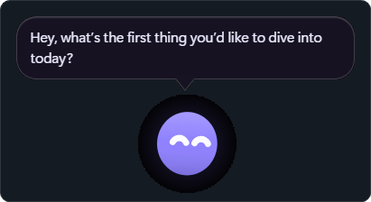
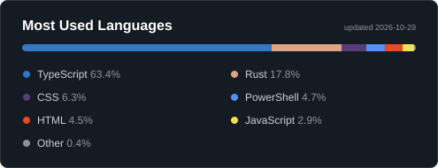
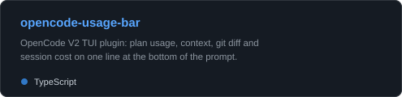
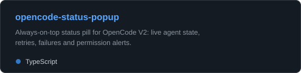

## bubo

  <strong>A tiny English tutor that lives in a floating window on your desktop.</strong> 
  Chat in English, get live corrections, and turn your mistakes into spaced-repetition practice.

  

  
  
  
  

  <a href="https://lucasinstra.github.io/bubo/">Website</a> ·
  <a href="https://github.com/LucasInstra/bubo/releases">Download</a> ·
  <a href="https://github.com/LucasInstra/bubo">Source</a>

## Languages

  

## Projects

